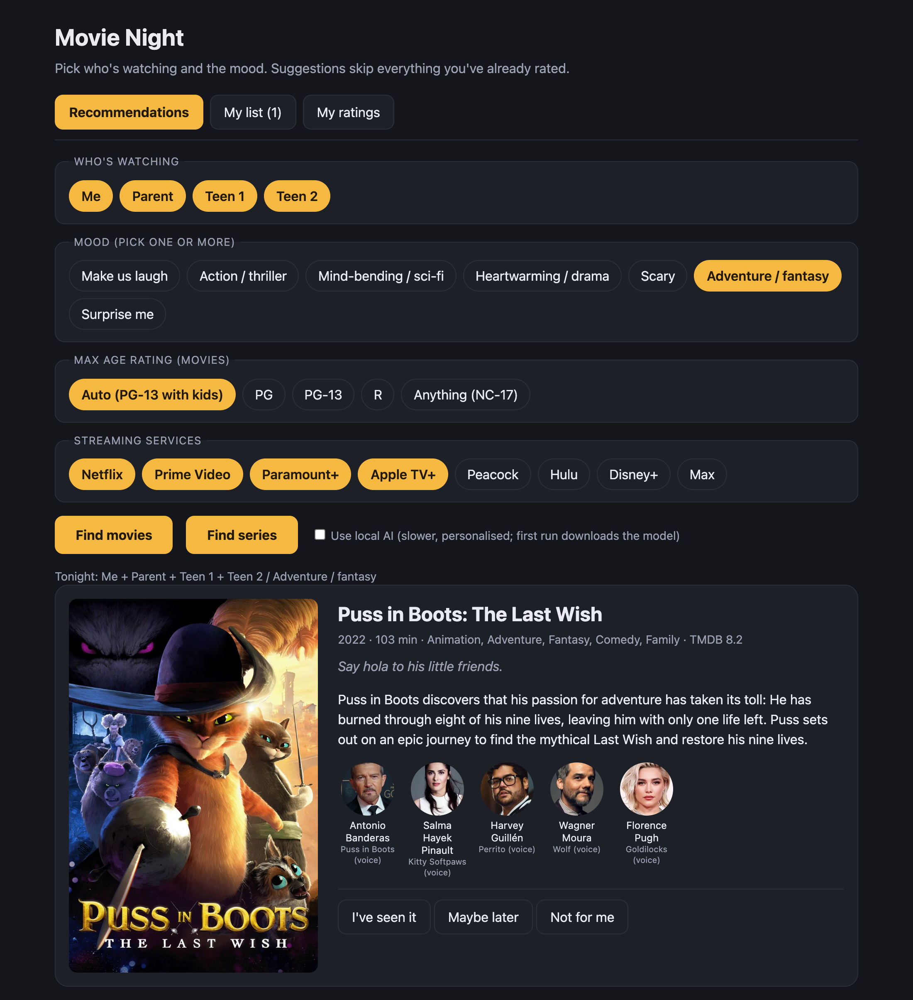
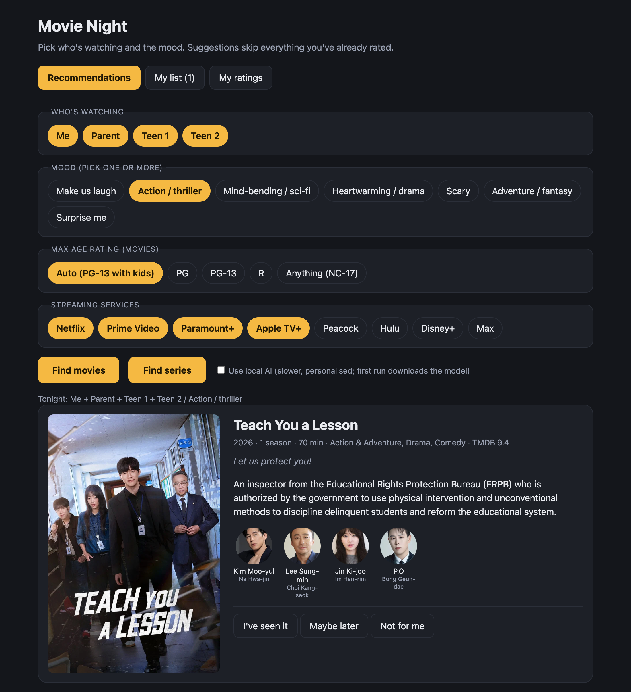
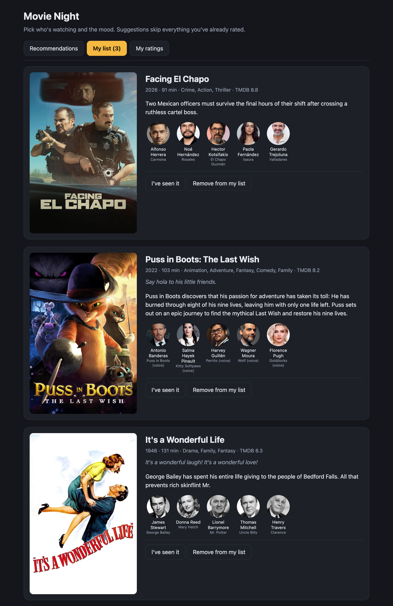
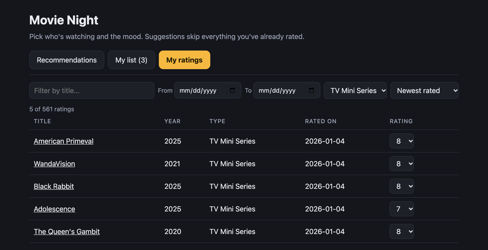

# Movie Night

A small local web app that answers "what do we watch tonight?" for movies and series.

It combines two sources:

- **Your IMDb ratings** (`ratings.csv`): what you've already seen is never suggested again, and your ratings shape a per-genre taste profile.
- **TMDB**: what is streaming right now on the services you pay for, plus posters, cast and synopses.

Optionally, a **local LLM** (via [MLX](https://github.com/ml-explore/mlx-lm), Apple Silicon) re-ranks the candidates against a written summary of your taste and adds a one-line "Why you" for each pick.

## Find movies

Pick who's watching, a mood (or several), a maximum age rating and your streaming services, then hit **Find movies**.

- **Who's watching** applies household rules: for example, anime only when everyone is OK with it, only big-studio animation for some viewers, and a PG-13 cap when kids are in the room.
- **Max age rating** overrides that cap: PG, PG-13, R or anything. Handy for horror nights.
- Each card has three actions: **I've seen it** (rate it 1–10), **Maybe later** (save it) and **Not for me** (never suggest it again, and it counts against that genre in your taste profile).

## Find series

The same flow for TV shows with **Find series**.

TMDB can't filter series by age rating, so the age-rating setting only applies to movies.

## My list

**Maybe later** saves a pick to *My list*. Switch between your list and fresh recommendations with the tabs. Items on the list are left out of future recommendations. Rating one from the list removes it.

## My ratings

Browse everything in `ratings.csv`: filter by title, date range or type, sort it, and change a rating from the dropdown. Updating a rating writes it to `ratings.csv` (with today's date) and sends it to your TMDB account if connected.

## Setup

1. Export your IMDb ratings (IMDb → Your Ratings → Export) and save the file as `ratings.csv` next to `app.py`.
2. Get a free TMDB API key at [themoviedb.org/settings/api](https://www.themoviedb.org/settings/api) and export it: `export TMDB_API_KEY=...`
3. Run `python3 app.py`. It opens <http://localhost:8765>.

Optional:

- **Local AI:** create a `.venv` with `mlx-lm` installed. The first run downloads the model.
- **TMDB account sync:** click *Connect TMDB* in the banner to send ratings to your TMDB account.
- There is also a terminal version: `python3 recommend.py`.

## Local files

These are created next to the code and are git-ignored, since they are personal:

| File | Purpose |
| --- | --- |
| `ratings.csv` | Your IMDb ratings; new and edited ratings are written here |
| `mylist.json` | The "Maybe later" list |
| `rejected.json` | "Not for me" picks |
| `taste.json` | Cached LLM taste summary |
| `config.json` | Selected services and TMDB session |
